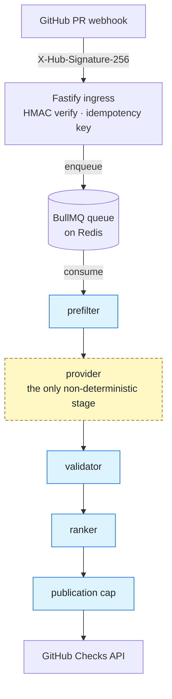

<div align="center">

<p>
  <picture><source media="(prefers-color-scheme: dark)" srcset="docs/assets/prisma-banner-dark.svg"></picture>
</p>

**Vendor-independent AI code review for GitHub pull requests.**

[](https://github.com/Rynaro/prisma/actions/workflows/ci.yml)
[](https://github.com/Rynaro/prisma/releases)
[](./LICENSE)
[](https://nodejs.org)
[](https://www.typescriptlang.org)
[](#deploy-to-production)

**[Quickstart](#quickstart--5-minutes-no-api-key-required)** · **[Features](#features)** · **[How it works](#how-it-works)** · **[Configuration](#configuration)** · **[Deploy](#deploy-to-production)** · **[Docs](#documentation)**

</div>

---

## What is prisma?

prisma is a GitHub App that reviews pull requests with the AI model of your choice. A webhook hits a small Fastify ingress, a BullMQ worker runs a deterministic pipeline (prefilter, provider, validator, ranker, publication cap), and the result is published as a GitHub Check: a summary plus, at most, a handful of inline comments. The model is the only non-deterministic stage, and it sits behind a single `Provider` interface, so Anthropic, GitHub Copilot and OpenAI are swapped by configuration rather than code.

> [!TIP]
> You can try prisma in about 5 minutes without an API key. `make eval` runs 26 deterministic scenarios against the built-in `FakeProvider`. See the [Quickstart](#quickstart--5-minutes-no-api-key-required).

## Features

<table>
<tr>
<td valign="top" width="33%">

**Vendor-independent providers**

Anthropic, GitHub Copilot or OpenAI behind one `Provider` interface. Switch by environment key or per-repo `model:` slug.

</td>
<td valign="top" width="33%">

**Trust-first publication**

At most 5 inline comments per PR and 1 per file, severity and confidence floors, and `dry-run` mode for new installations.

</td>
<td valign="top" width="33%">

**Deterministic evals**

26 offline scenarios run against `FakeProvider` with `make eval`, and the same gate runs in CI.

</td>
</tr>
<tr>
<td valign="top" width="33%">

**One-command self-hosting**

`bash deploy/install.sh` brings up the stack behind Traefik v3, with automatic Let's Encrypt TLS.

</td>
<td valign="top" width="33%">

**Ops console with auto-rollback**

`bin/prisma` deploys, health-gates on `/healthz/live`, and rolls back to the previous release on failure.

</td>
<td valign="top" width="33%">

**Per-repo configuration and guidance**

`.github/review-bot.yml` for custom instructions, path rules and context files. Talk to it with `@prisma-bot` commands.

</td>
</tr>
</table>

## Quickstart — 5 minutes, no API key required

Evaluate the bot against deterministic scenarios. No API key is needed.

1. **Clone the repository and enter it.**

   ```bash
   git clone https://github.com/Rynaro/prisma.git
   cd prisma
   ```

2. **Create a local env file.** Placeholder values are fine for the eval path.

   ```bash
   cp .env.example .env
   ```

3. **Install the workspace dependencies.** Everything runs in Docker, so nothing is installed on your host. The first run adds 5–10 minutes while the dev image builds.

   ```bash
   make install
   ```

4. **Run the evaluation scenarios.**

   ```bash
   make eval
   ```

   **Expected result:** `26 passed, 0 failed`. The report shows the per-scenario published-Check shape the bot would produce in production, rendered against the deterministic `FakeProvider`. No live API key is required.

5. **Read the report.**

   ```bash
   cat evals/last-report.md
   ```

6. **Optional: run the end-to-end smoke test.** It starts the app, worker and Redis, sends a signed webhook, and tears everything down. It takes about 45 seconds.

   ```bash
   make smoke
   ```

**Prerequisites:** Docker ≥ 20, GNU Make.

> [!NOTE]
> Want the longer walkthrough with troubleshooting? See [docs/quickstart.md](./docs/quickstart.md).

## What a review looks like

> [!NOTE]
> Illustrative only, in `summary-plus-inline` mode. The shape follows the Checks summary renderer (`renderSummary` in `packages/github/src/publisher/planner.ts`); the finding text is invented for this example.

```markdown
**Mode: summary-plus-inline**

### Inline (1)
- `src/payments/refund.ts:88` — **HIGH** (confidence 0.92) — Refund amount is not checked against the original charge

### Summary-only (1)
- `src/payments/refund.ts:121` — **MEDIUM** (confidence 0.64) — Retry path has no idempotency key _(confidence_below_floor)_

### Highlights (1)
- `src/payments/refund.ts` — **Idempotency key derived from the order ID** — A retry cannot issue a second refund for the same order.

Caps: per_pr=5 per_file=1. Floors: severity≥medium, confidence≥0.70.
```

A clean review renders `_No findings._` in place of the findings sections. Highlights appear only when `positive_feedback` is enabled.

## How it works



A single Fastify ingress accepts `POST /webhooks/github`, verifies `X-Hub-Signature-256`, derives an idempotency key and enqueues the job onto BullMQ, which is backed by Redis. Workers consume the queue and run the pipeline. Every stage except the provider is deterministic, and the publication cap enforces the [trust rules](#trust-by-design) before anything is written to GitHub.

### Provider selection

Set exactly one vendor key for production-equivalent behaviour. The first key found wins, in this order:

1. `ANTHROPIC_API_KEY`: Anthropic Claude, the reference adapter. Default model `claude-sonnet-5-5`; see [model-compatibility.md](docs/model-compatibility.md#anthropic).
2. `COPILOT_API_KEY`: GitHub Copilot ([ADR-004](./docs/architecture-decision-records/adr-004-copilot-provider.md)).
3. `OPENAI_API_KEY`: OpenAI ([ADR-005](./docs/architecture-decision-records/adr-005-openai-provider.md)), with deterministic `seed` support.
4. No key: the worker falls back to `FakeProvider`, a deterministic in-process provider with an empty script. It powers the no-key eval path and local development, and readiness reports not-ready without a key.

| Provider | Package | Seed-deterministic | Notes |
|----------|---------|:--:|-------|
| Anthropic Claude | `@prisma-bot/provider-anthropic` | — | Reference adapter ([ADR-002](./docs/architecture-decision-records/adr-002-provider-abstraction.md)) |
| GitHub Copilot | `@prisma-bot/provider-copilot` | — | [ADR-004](./docs/architecture-decision-records/adr-004-copilot-provider.md) |
| OpenAI | `@prisma-bot/provider-openai` | yes | First adapter honoring a deterministic `seed` ([ADR-005](./docs/architecture-decision-records/adr-005-openai-provider.md)) |
| Fake | `@prisma-bot/provider-fake` | yes | Deterministic; evals and keyless development |

<details>
<summary>Why one vendor boundary</summary>

The provider stage is the only non-deterministic component. The `Provider` interface ([ADR-002](./docs/architecture-decision-records/adr-002-provider-abstraction.md)) is the single line vendor-specific code crosses, and `make check-vendor-isolation` enforces it mechanically: vendor SDKs and the network primitive (`fetch`) are confined to each adapter's `client.ts`. Adding a provider is additive, a new adapter under `packages/providers/` that satisfies the interface and its schemas, with no change to `packages/core` (the ADR-004 precedent, which added Copilot without touching core, shared schemas or evals). Provider selection itself is wired in `apps/github-app/src/worker.ts`.

</details>

## Trust by design

Trust preservation beats maximum coverage. Findings are validated, ranked and capped before anything is published.

- **Caps:** 5 inline comments per PR (`comment_cap.per_pr`) and 1 per file (`comment_cap.per_file`).
- **Floors:** inline comments require severity ≥ `medium` and confidence ≥ `0.7`.
- **Dry-run by default:** new installations run in `dry-run`, so you see findings in the Checks summary before any inline comment is written.
- **Per-repo tuning:** every threshold is set per repository in `.github/review-bot.yml`.
- **Untrusted guidance:** custom guidance is injected as data beneath an immutable system prompt. It can focus the review but can never override the output schema or finding categories.

> [!IMPORTANT]
> The bot never submits `REQUEST_CHANGES`. Its only review action is an approval, and that is opt-in, honored only from the repository's default branch, and dismissed if a later commit is no longer clean. A pull request cannot grant itself an approval by shipping config in its own diff.

<details>
<summary>Caps, floors and the approval safety posture in detail</summary>

- The default caps and floors are `comment_cap: {per_pr: 5, per_file: 1}` and `thresholds: {severity_floor: {inline: medium}, confidence_floor: {inline: 0.7}}`. The validator, ranker and publisher apply them in that order, and [ADR-003](./docs/architecture-decision-records/adr-003-validation-ranking.md) records the reasoning.
- Dedupe rules and the full mode matrix are in [docs/publication-policy.md](./docs/publication-policy.md).
- Approval keys (`approval.celebrate_clean`, `approval.clean_conclusion`, `approval.approve_on_clean`) all default off. `approve_on_clean` is honored only when the config is resolved from the default branch. The bot submits one idempotent `APPROVE` review and never `REQUEST_CHANGES`.
- Guidance is limited to 2,048 bytes per instruction block, 20 path instructions and 5 context files. The total rendered guidance is capped at 7,500 tokens, well below the diff budget, so guidance can never evict the diff. Missing context files degrade gracefully.
- The threat model covers the remaining risks and mitigations: [docs/threat-model.md](./docs/threat-model.md).

</details>

## Configuration

Everything lives in `.github/review-bot.yml` in the target repository. Every key is optional, and absent keys fall back to safe defaults. The file is read from the PR's head ref and treated as untrusted input. A complete, annotated example that uses every default is in [docs/config-spec.md § Worked example](./docs/config-spec.md#worked-example-verbatim-block).

```yaml
mode: dry-run                       # dry-run | summary-only | summary-plus-inline

review_guidance:
  instructions: |
    Check for proper error handling. Each async operation must have a
    clear failure mode. Prefer specific error types over generic Error.
  path_instructions:
    - path: "src/payments/**"
      instructions: |
        Payment processing requires audit logging and idempotency keys.
        Flag any currency conversions without rounding checks.
  context_files:
    - path: "docs/architecture.md"
    - path: "docs/SECURITY_RULES.md"

positive_feedback:
  enabled: true
  max_items: 3                      # 1–5

approval:
  celebrate_clean: true             # swap "_No findings._" for an approval message
  clean_conclusion: success         # neutral | success
  approve_on_clean: true            # default-branch config only; never REQUEST_CHANGES

interactions:
  enabled: true
  max_per_review: 3                 # 1–25 provider-backed replies per review round

nickname: prbot                     # also accept @prbot
command_marker: "@"                 # @ (default) | $ | ! | /
```

<details>
<summary>review_guidance: custom instructions, path rules and context files</summary>

Shape how the bot reviews your code with three optional sub-keys:

- `instructions`: free text (up to 2,048 bytes) applied to every review.
- `path_instructions`: up to 20 entries, each a `path` glob and up to 2,048 bytes of `instructions`. Only entries matching changed files are sent to the model.
- `context_files`: up to 5 repo-relative paths. Each is fetched and injected as reference material (max 64 KiB, truncated on a UTF-8 boundary).

Guidance is injected as **untrusted data** beneath an immutable system prompt. Your rules can focus the review but never override the output schema or finding categories. Missing context files degrade gracefully, the token budget is enforced, and the diff is never evicted. Full guide: [docs/custom-review-prompts.md](./docs/custom-review-prompts.md). Reference: [docs/config-spec.md § review_guidance](./docs/config-spec.md#review_guidance).

</details>

<details>
<summary>positive_feedback: highlights on a good diff</summary>

Default off. When `enabled: true`, the model may also name up to `max_items` concrete good decisions it can verify in the diff, rendered as a `### Highlights` section of the Checks summary. Highlights are never findings: they have no line anchor, no severity and no category, and they never take an inline-comment slot or count against `comment_cap`. With `enabled: false` (or the key absent), prompt bytes, tool schema and rendered summary are byte-identical to a build without the feature.

Reference: [docs/config-spec.md § positive_feedback](./docs/config-spec.md#positive_feedback).

</details>

<details>
<summary>approval: clean-review behavior and its safety posture</summary>

Default off. A **clean review** means the provider and validator both produced zero findings on a real, non-partial run. It is never inferred from the rendered summary.

- `celebrate_clean` replaces the dry `_No findings._` body with a short approval message.
- `clean_conclusion` sets the check-run conclusion to `success` instead of the default `neutral`. It is a separate key so that a text-only opt-in never silently changes a machine-readable signal.
- `approve_on_clean` submits one real, idempotent GitHub `APPROVE` review via `pulls.createReview`. It is honored **only when resolved from the repository's default branch**, so a PR cannot grant itself an approval by shipping config in its own diff. The bot never submits `REQUEST_CHANGES`. A later commit that is no longer clean dismisses the earlier approval instead.
- All three keys are inert in `dry-run`, where nothing PR-visible is published, approval included.

Reference: [docs/config-spec.md § approval](./docs/config-spec.md#approval) and [docs/publication-policy.md](./docs/publication-policy.md).

</details>

<details>
<summary>interactions: talk to the reviewer</summary>

Default off. With `enabled: true`, `@prisma-bot ask <message>` lets a developer ask or tell the reviewer something about the latest round's findings, for example "why is finding 2 a security risk?" or "we sanitize upstream, this is a false positive". The reply is grounded in that round's findings and check-run summary, and it quotes your question so each exchange is self-contained.

`max_per_review` hard-caps provider-backed replies per review round, and a new round resets the budget. When it is greater than 1, later replies in the same round also see the prior exchanges as thread context. GitHub is the only state: the budget lives in a hidden marker in the bot's own reply comments, with no database. Disabled (the default), `ask` returns a friendly opt-in notice and makes no provider call.

Reference: [docs/config-spec.md § interactions](./docs/config-spec.md#interactions).

</details>

<details>
<summary>nickname and command_marker</summary>

- `nickname` (login-shaped, 1–39 characters) makes both `@prisma-bot` and the nickname valid triggers, for example `@prbot`. Matching is case-insensitive.
- `command_marker` picks the prefix character. The allowed values are `@` (default), `$`, `!` and `/`. Use anything other than `@` to avoid GitHub's `@`-autocomplete, which can ping real users who share a name prefix with the bot.

> [!WARNING]
> GitHub renders `$...$` pairs as inline math (LaTeX). A lone `$josie` at the start of a line, with no matching `$` on the same line, is plain text and is the safe common pattern. Keep command comments from forming a closed `$...$` pair on their first line.

</details>

<details>
<summary>Every other key, with defaults</summary>

| Key | Default | What it controls |
|-----|---------|------------------|
| `enabled` | `true` | Set `false` to skip the pipeline for the repository. |
| `mode` | `dry-run` | `dry-run`, `summary-only` or `summary-plus-inline`. |
| `provider` / `model` | `anthropic` / unset | Prefer the `provider/name` slug on `model:` (for example `openai/gpt-5.4-nano`). |
| `generation` | `{}` | Vendor-neutral `max_output_tokens`, `temperature`, `top_p`, `seed`. |
| `provider_options` | `{}` | Raw passthrough keyed by provider slug. Denylisted keys are documented in [config-spec](./docs/config-spec.md#provider_options). |
| `thresholds` | medium / 0.7 | Inline severity and confidence floors. |
| `comment_cap` | 5 / 1 | Inline caps per PR and per file. |
| `path_rules` | empty | `include` and `exclude` globs. |
| `exclude_generated`, `exclude_vendored` | `true`, `true` | Built-in generated and vendored file detection. |
| `max_files`, `max_changed_lines` | 50, 2000 | Single-call thresholds. Above them the PR is chunked, and above the chunking ceiling it is skipped as oversized. |
| `chunking` | enabled, 200 files, 12,000 lines, 6 provider calls | Diff chunking for large PRs. Chunking can multiply provider cost, so see [config-spec § chunking](./docs/config-spec.md#chunking). |
| `categories_enabled`, `severity` | all categories / none | Category filter and per-category severity overrides. |
| `repo_heuristics` | all `true` | Security, tests, migrations and layering weighting. |
| `language_overrides` | empty | Per-language overrides of thresholds and related keys. |

Full reference: [docs/config-spec.md](./docs/config-spec.md). Precedence is language override, then repo config, then built-in defaults.

</details>

## Commands

Mention the bot in a PR comment to trigger actions without opening the GitHub UI:

```
@prisma-bot review
@prisma-bot full review
@prisma-bot help
@prisma-bot configuration
@prisma-bot ask <message>
```

| Command | What it does |
|---------|-------------|
| `review` | Incremental re-review: only files not already covered in prior rounds of this PR are reviewed. |
| `full review` | Full re-review: all diff files are reviewed from scratch, ignoring prior-round dedupe state. |
| `help` | Replies with the command vocabulary in a PR comment. No provider call is made. |
| `configuration` | Replies with the resolved repo configuration (mode, caps, thresholds). No provider call is made. |
| `ask <message>` | Discuss the review feedback (opt-in; see [interactions](#configuration)). |

<details>
<summary>Nickname and command marker</summary>

Set `nickname: prbot` to accept `@prbot` alongside `@prisma-bot`. Mention matching is case-insensitive, so `@Prbot` and `@prbot` are equivalent. Set `command_marker: "$"` to write `$prisma-bot review` instead of `@prisma-bot review`. Allowed markers are `@` (default), `$`, `!` and `/`, and all four share the same syntax. See [Configuration](#configuration) for the `$`-as-LaTeX caveat.

</details>

<details>
<summary>Ack protocol</summary>

When the bot receives a recognised command it adds a 👀 reaction to acknowledge receipt. The reaction is fail-open, so the review continues even if the call fails. On success it adds a 👍 reaction and, for `help` and `configuration`, optionally posts a reply comment. The 👀 reaction is posted only after the marker and identity checks pass, so the bot does not react to comments addressed to other people or to the wrong marker.

</details>

<details>
<summary>Loop prevention</summary>

Comments authored by the bot itself, or by any `[bot]` account, are discarded at the worker level. The job resolves to `discarded_idempotent` with no provider call.

</details>

<details>
<summary>Graceful degradation</summary>

If the bot's login cannot be resolved (`GITHUB_APP_SLUG` unset), comment events are still processed. The loop-prevention check becomes a no-op for that delivery. Unknown or empty command text returns the `help` reply instead of an error.

</details>

## Deploy to production

One interactive command from a clean clone. It runs behind Traefik v3 with automatic TLS:

```bash
bash deploy/install.sh
```

For non-interactive deployment, every prompt is answered from an environment variable:

```bash
bash deploy/install.sh --yes
```

<details>
<summary>What the installer does</summary>

- Runs preflight checks: Docker, Compose v2, ports 80 and 443, and a warn-only DNS check.
- Prompts for the domain, the ACME email, the GitHub App ID and slug, the path to the App's `.pem` private key, and the provider choice. API keys are read silently, so secrets never echo.
- Generates `GITHUB_APP_WEBHOOK_SECRET` with `openssl`, and writes `deploy/.env` with `chmod 600`.
- Brings up the production stack: app, worker, Redis (internal only, no published ports) and Traefik v3. The only published ports are 80 and 443.
- Configures automatic TLS through Let's Encrypt, using ACME HTTP-01. The DNS-01 variant is sketched in comments in `deploy/traefik/traefik.yml`.
- Waits for `https://<domain>/healthz/live`, then prints the webhook URL and secret to paste into your GitHub App registration.

`--yes` mode reads these variables. It fails if a required one is missing.

| Variable | Purpose |
|----------|---------|
| `PRISMA_DOMAIN` | Public domain, with no scheme and no slash |
| `PRISMA_ACME_EMAIL` | ACME and Let's Encrypt registration email |
| `GITHUB_APP_ID` | Numeric GitHub App ID |
| `GITHUB_APP_SLUG` | GitHub App slug |
| `PRISMA_PEM_PATH` | Path to the GitHub App `.pem` private key |
| `PRISMA_PROVIDER_CHOICE` | `anthropic`, `copilot` or `openai` |
| `ANTHROPIC_API_KEY` / `COPILOT_API_KEY` / `OPENAI_API_KEY` | The key that matches the chosen provider |
| `OTEL_EXPORTER_OTLP_ENDPOINT` | Optional. Leave unset to disable telemetry export |
| `PRISMA_FORCE_ENV_OVERWRITE=1` | Allows `--yes` to overwrite an existing `deploy/.env` |

Run `bash deploy/install.sh --help` for the same list.

</details>

Integrating the App for the first time? Follow the [GitHub App installation guide](./docs/install-github-app.md) after the stack is up. Full deployment reference, including env vars, topology, secrets, networking and health surfaces: [docs/deployment.md](./docs/deployment.md).

Images are published to `ghcr.io/rynaro/prisma-bot` (`v0.16.0`, `latest`, immutable `sha-<short>` per commit). Full reference: [docs/deployment.md](./docs/deployment.md).

### Alternative: Kamal

Prefer Kamal? A single-host alternative uses Kamal with kamal-proxy (native TLS) and a Redis accessory, documented in [docs/deployment-kamal.md](./docs/deployment-kamal.md).

> [!WARNING]
> The Compose and Traefik path above and the Kamal path are mutually exclusive on a single host, because both bind ports 80 and 443. Pick one.

## Operate the deployment

Once installed, `bin/prisma` is total control over the running stack. It is an interactive console for humans and a flag-driven interface for automation such as CI, cron and LLM operators.

```bash
bin/prisma                              # interactive TUI console
bin/prisma --update --tag v0.4.0 --yes  # headless: pull, redeploy, health-gate,
                                        # auto-rollback to the previous release on failure
bin/prisma --rollback --yes             # back to the previous recorded release
bin/prisma status                       # services, image pin, liveness at a glance
bin/prisma doctor                       # full diagnostic (env, perms, DNS, disk, health)
```

| Command | What it does |
|---------|--------------|
| `update` | Deploy a new image: pull, recreate, gate on `/healthz/live`, and auto-roll back on failure. `--tag` takes `latest`, `vX.Y.Z`, `sha-<short>` or `tag@sha256:…`. Also `--sync`, `--no-rollback` and `--no-health`. |
| `rollback` | Redeploy the previous recorded release, or `--tag TAG`. |
| `releases` | Show the recorded release history (`deploy/.releases`). |
| `status` | Services, image tag and digest, and liveness at a glance. |
| `health` | Probe `https://$PRISMA_DOMAIN/healthz/live`. `--timeout N`. |
| `logs` | Tail logs. `[SERVICE] [--tail N] [--follow]`. |
| `restart` | Restart all services or one. |
| `up` / `down` | Bring the stack up (health-gated), or stop it. `down` asks first and preserves data. |
| `scale` | Scale worker replicas with `--workers N`. |
| `config` | `show`, `get KEY` or `set KEY=VALUE`. Secrets are redacted in `show`. |
| `backup` / `restore` | Snapshot Redis (`BGSAVE`) to `deploy/backups/`, or restore from `--file PATH`. Restore asks first. |
| `doctor` | Run every preflight and runtime diagnostic. |
| `version` | CLI, image and checkout versions. |

Global options: `--yes` never prompts, which suits CI and cron. `--timeout N` sets the health-gate deadline (default 120 seconds). Full reference: [docs/operations.md](./docs/operations.md).

## Under the hood

Built for production, and written to be read.

- **Language and runtime:** TypeScript 5.7, Node `>=22 <23`, pnpm 9.15.0 workspace monorepo.
- **Framework and queue:** Fastify 5 for ingress, BullMQ 5 on Redis for the queue, `ioredis` for the connection.
- **Deployment:** Docker images on GHCR, Traefik v3 with automatic TLS, and a Kamal alternative.
- **Containerized CI:** typecheck, Biome lint (with the vendor-isolation check), Vitest, and the eval gate, all run in containers on every push and pull request to `main`.

```
apps/github-app/     Fastify ingress, BullMQ worker, pipeline orchestrator, repo config, interactions
packages/config/     .github/review-bot.yml loader and parser
packages/core/       prefilter, batcher and diff splitter, validator, ranker, snapshotter, augmentation
packages/github/     publisher and planner, Checks, PR reviews, comments, interactions, installation auth
packages/providers/  anthropic (reference), copilot, openai, fake
packages/shared/     Zod schemas, prompt builders, token estimator, audit log and redactor
evals/               scenarios.yaml (26), fixtures and the eval runner
deploy/              install.sh, docker-compose.prod.yml, Traefik config
bin/prisma           ops console
config/, .kamal/     Kamal deploy configuration (alternative path)
docs/                specs, guides, ADRs and threat model
```

<details>
<summary>Ingress, idempotency and security</summary>

- **HMAC verification.** The ingress checks `X-Hub-Signature-256` with `crypto.timingSafeEqual` over equal-length buffers, before any work is queued.
- **Idempotency keys.** Each job gets a `prisma_<sha256>` key derived from a canonical JSON of `delivery_id`, `installation_id`, `repository_id`, the pull request number and `head_sha`, plus `comment_id` or `check_run_id` where they apply. A job whose key is a duplicate resolves to `discarded_idempotent` instead of running again.
- **Secret handling.** The emission-time redactor is fail-closed for installation tokens, webhook secrets and provider API keys. If a secret-shaped value appears in a payload position, the whole event is dropped and counted in `prisma_redactor_dropped_total`.
- **Approval scope.** Approvals are the only review action the App submits, and it never submits `REQUEST_CHANGES` (see [Trust by design](#trust-by-design)).

</details>

<details>
<summary>Observability</summary>

- **Logs.** Structured JSON to stdout, one event per line, with a fixed top-level field set. Nothing ships logs itself, so the platform handles collection.
- **Metrics and traces.** OpenTelemetry SDK, exported over OTLP/HTTP to an operator-supplied collector (`OTEL_EXPORTER_OTLP_ENDPOINT`). No observability vendor is pinned. Sampling is parent-based with a head-sample default of `1.0`, set with `OTEL_TRACES_SAMPLER_ARG`.
- **Redaction allowlist.** Only fields on an explicit allowlist can leave the process. Diff content, repository file bodies and raw provider output are dropped at emission time. See [docs/observability.md](./docs/observability.md) for the event catalogue and the allowlist.
- **Health surfaces.** `GET /healthz/live` (liveness), `GET /healthz/ready` (bootstrap complete, including the provider key and Redis) and `GET /healthz/deps` (dependency probe).

</details>

<details>
<summary>Failure modes and data flow</summary>

[docs/data-flow.md](./docs/data-flow.md) covers the happy, oversized, failed, malformed and replay flows. Oversized PRs fall back to summary-only output, malformed provider output degrades to summary-only, and replayed deliveries are handled through the idempotency key. The risks and their mitigations are in [docs/threat-model.md](./docs/threat-model.md).

</details>

<details>
<summary>Evaluation and test coverage</summary>

- **Tests.** 1312 Vitest tests across 58 files, all hermetic. GitHub interactions go through `OctokitLike` fakes and provider interactions through `FakeProvider`.
- **Evals.** 26 deterministic scenarios in `evals/scenarios.yaml`, covering security findings, missing tests, risky migrations, the harmless-refactor false-positive guard, generated files, lockfile noise, malformed provider output, cross-hunk dedupe, oversized PRs, custom guidance, context files, chunked PRs, provider-options round-trips, reasoning-model empty reviews and approval behavior. The report is written to `evals/last-report.md`. The scenario index is in [evals/README.md](./evals/README.md).

</details>

## Status

**v0.16.0** — Claude 5.x compatibility (#45). The Anthropic provider now supports `claude-haiku-5-5`, `claude-sonnet-5-5`, `claude-opus-5-5` and `claude-fable-5-1`. The default model changes from the retired `claude-3-5-sonnet-latest` (which returned 404) to `claude-sonnet-5-5`. Set `ANTHROPIC_MODEL` to choose another, and per-repo `model: anthropic/…` is now honored. Claude 5.x reviews use `auto` tool choice with a strict tool schema and one retry, instead of the forced tool call these models reject. The output cap is 16,384 tokens (4096 for older models; `ANTHROPIC_MAX_OUTPUT_TOKENS` wins), and the window is 1M tokens. Safety refusals get their own notice and are never retried. Retired-model 404s and rejected requests now surface as `capability` errors with remedies. See [ADR-009](./docs/architecture-decision-records/adr-009-anthropic-5x-model-family-compatibility.md) and [docs/model-compatibility.md § Anthropic](./docs/model-compatibility.md#anthropic).

- 1312 tests across 58 files, all passing · 26/26 deterministic eval scenarios PASS
- Containerized CI (typecheck, lint, test, eval) on every push and PR to `main`
- TypeScript · Node >=22 <23 · pnpm 9.15.0 workspace monorepo
- Container images: `ghcr.io/rynaro/prisma-bot`
- Built on [Fastify](https://fastify.dev), [BullMQ](https://docs.bullmq.io), and Redis

## Documentation

Organized by what you want to do (Diátaxis).

### Get started

| Doc | What it's for |
|-----|---------------|
| [Quickstart](./docs/quickstart.md) | 5-minute evaluator tutorial with troubleshooting |
| [GitHub App installation](./docs/install-github-app.md) | Install the App on your org |
| [Customize the review](./docs/custom-review-prompts.md) | Add custom guidance and context files |
| [Deployment](./docs/deployment.md) | Env vars, topology, secrets, networking, health surfaces |
| [Deployment with Kamal](./docs/deployment-kamal.md) | Alternative single-host Kamal path |
| [Contributing](./docs/contributing.md) | Workspace, tests, ADRs, adding a provider |

### Operate

| Doc | What it's for |
|-----|---------------|
| [Operations](./docs/operations.md) | The `bin/prisma` ops console and its subcommands |
| [Operational runbooks](./docs/operational-runbooks.md) | Runbooks and numeric tunables |

### Reference

| Doc | What it's for |
|-----|---------------|
| [Configuration spec](./docs/config-spec.md) | `.github/review-bot.yml` schema and resolution order |
| [API contracts](./docs/api-contracts.md) | Internal pipeline contracts |
| [Review findings schema](./docs/review-findings-schema.md) | `NormalizedFinding`, `dedupe_key`, `RejectionLogEntry` |
| [Observability](./docs/observability.md) | Logs, metrics, traces, redaction allowlist |
| [Publication policy](./docs/publication-policy.md) | Modes, caps, dedupe behavior |
| [Model compatibility](./docs/model-compatibility.md) | Per-vendor model matrix and error remedies |

### Understand

| Doc | What it's for |
|-----|---------------|
| [System design](./docs/system-design.md) | Components, schemas, end-to-end sequence |
| [Data flow](./docs/data-flow.md) | Happy, oversized, fail, malformed and replay flows |
| [Threat model](./docs/threat-model.md) | Risks and mitigations |
| [Research summary](./docs/research-summary.md) | OSS landscape and decisions |
| [MVP scope](./docs/mvp-scope.md) · [Open questions](./docs/open-questions.md) · [Product spec](./docs/product-spec.md) · [Evaluation plan](./docs/evaluation-plan.md) | Scope, open questions, product spec and eval plan |

### Decisions (ADRs)

| ADR | Title |
|-----|-------|
| [ADR-001](./docs/architecture-decision-records/adr-001-github-app.md) | Deliver as a GitHub App |
| [ADR-002](./docs/architecture-decision-records/adr-002-provider-abstraction.md) | Provider Abstraction |
| [ADR-003](./docs/architecture-decision-records/adr-003-validation-ranking.md) | Validation, Ranking, and Publication Cap |
| [ADR-004](./docs/architecture-decision-records/adr-004-copilot-provider.md) | GitHub Copilot Provider Adapter |
| [ADR-005](./docs/architecture-decision-records/adr-005-openai-provider.md) | OpenAI Provider Adapter |
| [ADR-006](./docs/architecture-decision-records/adr-006-diff-chunking-stability.md) | Diff-Chunking Stability: Derived Token Budget and Hunk-Level Splitting |
| [ADR-007](./docs/architecture-decision-records/adr-007-openai-responses-endpoint.md) | OpenAI Responses Endpoint: Selection, State Policy, Reasoning Translation, and Seed Capability |
| [ADR-008](./docs/architecture-decision-records/adr-008-gpt6-model-family-compatibility.md) | GPT-6 / GPT-6.1 Model-Family Compatibility: Window, Tokenizer, Sampling, Output Budget, and Error Remedies |
| [ADR-009](./docs/architecture-decision-records/adr-009-anthropic-5x-model-family-compatibility.md) | Anthropic Claude 5.x Model-Family Compatibility: Tool Choice, Strict Schema, Output Budget, Window, Tokenizer, Refusals, and Error Remedies |

All environment variables are enumerated in [docs/deployment.md § Environment variables](./docs/deployment.md#environment-variables). This README does not duplicate the table.

## Contributing

Read [docs/contributing.md](./docs/contributing.md) before opening a pull request. It covers the workspace layout, the test and eval commands, the ADR convention and the steps for adding a provider. A new provider is an additive change: a new adapter package under `packages/providers/` that satisfies the `Provider` interface, with no change to the core pipeline.

## License

[MIT](./LICENSE)

<div align="center">
<sub>Built with Fastify, BullMQ and Redis · MIT licensed</sub>
</div>
